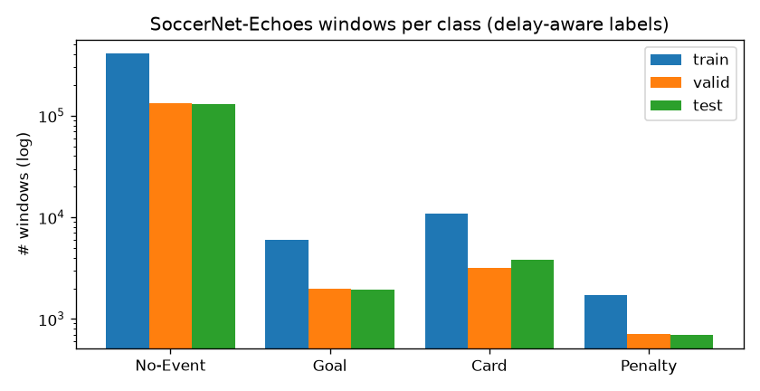
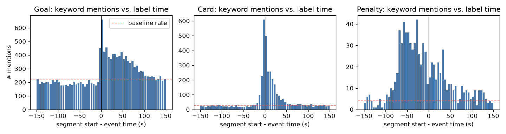

# Data survey (auto-generated by `scripts/survey_data.py`)

Config: ASR variant `auto_en`, labels `official`, split `official`, delay window [-5.0, 15.0] s, context 1+1+1 segments.

## 1. SoccerNet-Echoes x Labels-v2

Games with transcript + labels: train **283**, valid **90**, test **93**. Skipped: {'no_transcript': 34, 'no_split(challenge)': 50}. Duplicate Labels-v2 annotations merged: 488.

### Ground-truth events (Labels-v2) in these games

| split | Goal | Yellow card | Red card | Yellow->red card | Penalty |
|---|---|---|---|---|---|
| train | 908 | 1124 | 33 | 21 | 86 |
| valid | 309 | 330 | 9 | 4 | 32 |
| test | 302 | 388 | 8 | 13 | 37 |

### Window samples per class (one per ASR segment)

| split | No-Event | Goal | Card | Penalty | % events |
|---|---|---|---|---|---|
| train | 409002 | 6015 | 10794 | 1715 | 4.33% |
| valid | 132315 | 1974 | 3194 | 705 | 4.25% |
| test | 131219 | 1923 | 3803 | 702 | 4.67% |

Halves per commentary language: en: 272, es: 249, ru: 192, de: 119, fr: 88, tr: 4, it: 4, pl: 2

## 2. Commentator delay

| class | #events | with keyword mention in [-30,+90] s | first-mention delay p10/p25/p50/p75/p90 (s) |
|---|---|---|---|
| Goal | 1517 | 1450 | -29.6 / -22.3 / -2.8 / 5.5 / 27.5 |
| Card | 1928 | 1506 | -11.5 / -5.0 / -0.8 / 3.7 / 16.0 |
| Penalty | 155 | 128 | -32.1 / -28.1 / -21.8 / -8.2 / 24.5 |

### Which labelling window matches the commentary? (train games)

Share of events with at least one segment mentioning the class keyword inside the window. Segments of an event whose window misses the commentary are labelled as the event although nothing in them says so.

| class | #events | [-5,15] s | [-15,15] s | [-30,10] s | [-60,5] s | [-90,10] s |
|---|---|---|---|---|---|---|
| Goal | 906 | 69% (chance 33%) | 73% (chance 45%) | 74% (chance 50%) | 80% (chance 70%) | 89% (chance 79%) |
| Card | 1176 | 60% (chance 1%) | 68% (chance 2%) | 67% (chance 2%) | 63% (chance 4%) | 69% (chance 6%) |
| Penalty | 86 | 37% (chance 6%) | 55% (chance 6%) | 73% (chance 7%) | 87% (chance 13%) | 92% (chance 16%) |

Chance = the same window placed at a random time at least 5 min away from every event of the class. The useful signal is the gap between the two numbers.

## 3. SoccerNet-Caption (labelled by Labels-caption.json, or alignment for the mirror)

| subset | No-Event | Goal | Card | Penalty |
|---|---|---|---|---|
| all games | 30688 | 1322 | 1838 | 170 |
| train games only (used) | 18230 | 784 | 1128 | 94 |

Train No-Event captions mentioning goal/card/penalty (natural hard negatives): 6902

## 4. Kaggle Football Events

| games | No-Event | Goal | Card | Penalty | overlap w/ SoccerNet | overlap w/ valid+test (removed) |
|---|---|---|---|---|---|---|
| 10112 | 872694 | 24446 | 41163 | 2706 | 229 | 96 |

## 4b. Other Whisper transcripts of the train games (`asr_views`, English text)

| variant | No-Event | Goal | Card | Penalty |
|---|---|---|---|---|
| whisper_v1 | 71777 | 975 | 1773 | 274 |
| whisper_v1_en | 204857 | 3364 | 5793 | 952 |
| whisper_v2 | 83963 | 1088 | 2192 | 328 |
| whisper_v2_en | 86281 | 1166 | 1971 | 287 |
| whisper_v3 | 71415 | 913 | 1982 | 238 |
| **total** | 518293 | 7506 | 13711 | 2079 |

## 4c. Live-text commentary (HF `falahmanalodi/Football-Commentary`, MIT, PL 2024-25)

| matches | No-Event | Goal | Card | Penalty | penalty mentions labelled No-Event |
|---|---|---|---|---|---|
| 189 | 15645 | 1392 | 1243 | 127 | 906 |

Penalty lines by type: comment 8, PM 7, penalty save 9, highlight 36, PSG 52, var 15

## 5. Natural hard negatives inside Echoes (No-Event windows mentioning a class keyword)

| split/keyword | #windows |
|---|---|
| test/Card | 657 |
| test/Goal | 12034 |
| test/Penalty | 945 |
| train/Card | 1789 |
| train/Goal | 35340 |
| train/Penalty | 2746 |
| valid/Card | 591 |
| valid/Goal | 11230 |
| valid/Penalty | 854 |

## 6. Label noise

Games whose number of `Goal` annotations differs from the final score in the game name: **7**.

| game | #Goal labels | goals in score |
|---|---|---|
| europe_uefa-champions-league/2014-2015/2015-02-18 - 22-45 Schalke 0 - 2 Real Madrid | 3 | 2 |
| europe_uefa-champions-league/2015-2016/2015-11-24 - 22-45 Barcelona 6 - 1 AS Roma | 6 | 7 |
| europe_uefa-champions-league/2016-2017/2017-04-18 - 21-45 Real Madrid 4 - 2 Bayern Munich | 3 | 6 |
| germany_bundesliga/2016-2017/2017-01-29 - 19-30 1. FSV Mainz 05 1 - 1 Dortmund | 1 | 2 |
| germany_bundesliga/2016-2017/2017-04-29 - 16-30 Dortmund 0 - 0 FC Koln | 1 | 0 |
| spain_laliga/2014-2015/2015-05-17 - 20-00 Espanyol 1 - 4 Real Madrid | 6 | 5 |
| spain_laliga/2016-2017/2017-05-14 - 21-00 Real Madrid 4 - 1 Sevilla | 6 | 5 |
